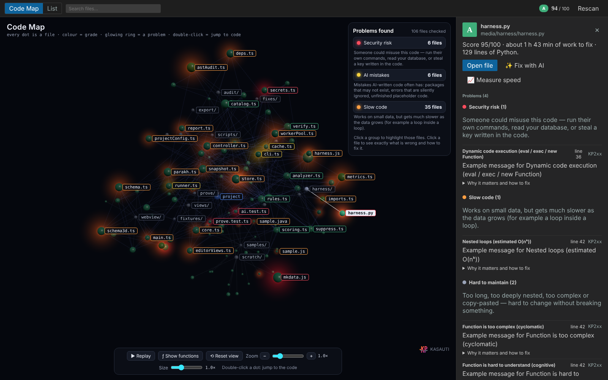

# KASAUTI — 360° Code Audit, Proof & Quality Visualizer

**कसौटी** is the touchstone a goldsmith rubs metal against to judge its purity. This extension does the same for code: it measures your codebase against published industry metrics, gives every file a grade from **A to E**, and shows the whole project as a **3D Code Map you can fly through** — updating live as you type.

Everything runs **offline** inside VS Code. No account, no server, no telemetry. The only network calls are the optional ones you switch on yourself: an AI provider you choose for fixes, and the PyPI/npm package check (both off by default).

---

## New in 2.2 — a 3D Code Map that explains itself



Open **KASAUTI: Open Code Map**. Every dot is a file (colour = grade); folders hold them, violet lines are imports, and a **glowing ring means a problem**. Drag to rotate, scroll to fly in and out, **double-click any dot to jump straight to the line in your code**. The *Problems found* panel says in plain words what is wrong — **Security risk**, **AI mistakes**, **Slow code** — and clicking one lights up only those files. Click a file to see each problem, why it matters and how to fix it, with **✨ Fix with AI** and **📈 Measure speed** buttons.

## New in 2.0 — "Parakh": audit AI-written code from every side

AI writes code fast; it also leaves loopholes. KASAUTI 2.0 checks code the way a reviewer would — and then **proves** its claims instead of guessing.

### 1. The 360° audit (deterministic, no AI involved)

26 new rules run on the same parse tree as the metrics, live as you type:

| Band | What it catches | Examples |
|---|---|---|
| **KP1xx Performance** | estimated Big-O from loop nesting, O(n) work inside loops, exponential recursion | nested loops → *estimated O(n²)*; `x in some_list` in a loop; `list.pop(0)`; naive `fib` |
| **KP2xx Security** | injection, secrets, unsafe loading, TLS off, weak hashes, XSS | f-string SQL in `execute`, `os.system("…" + x)`, hard-coded API keys (masked in the report), `pickle.loads`, `verify=False` |
| **KP3xx AI-risk** | the loopholes generated code typically leaves | **hallucinated / undeclared packages (slopsquatting)**, `except: pass`, placeholder stubs (`# … rest of the code`), unreachable code, mutable defaults |
| **KP4xx Simplify** | same behaviour, fewer lines | `if c: return True else: return False` → `return c`, `range(len(x))` → `enumerate`, manual sum loops |

Languages: Python, JavaScript, TypeScript/TSX, Java — and the secret scan works in **every** language. Every rule has a page with *why it matters*, *how to fix* and a **before → after** example ([rule index](media/rules/index.md)). Silence one line with `# kasauti-disable-next-line KP203`.

### 2. Prove Complexity — measured, not guessed

Put the cursor in a Python or JavaScript function → **KASAUTI: Prove Complexity**. It runs the function on generated inputs at n = 16, 32, 64 … (killed at a time limit), fits O(1) … O(2ⁿ) and draws the growth chart. A static *estimated O(n²)* becomes *measured O(n²), confidence high*.

### 3. Fix with AI (Verified) — any model you like

**The AI only proposes. KASAUTI decides.** Choose your model with **KASAUTI: Choose AI Provider**:

Ollama (local, free, default) · LM Studio · OpenAI · Anthropic Claude · NVIDIA NIM (Nemotron) · OpenRouter · Groq · any OpenAI-compatible URL · or the models VS Code already has (Copilot).

Every answer must pass five checks before the **Apply** button appears:

1. defines the same function, and parses
2. **no new security or AI-risk findings** — code that fails this is *never executed*
3. **no new third-party packages** (no hallucinated imports)
4. **identical results** to the original on edge cases (empty, duplicates, negatives, order) and random inputs
5. **not slower** — before/after Big-O measured and charted

A rejected answer goes back to the model with the exact reason, up to `kasauti.ai.maxAttempts` times. You get a diff and a proof panel; nothing changes until you click Apply (one Ctrl+Z undoes it). **KASAUTI: Show AI Model Scoreboard** shows which model's fixes actually pass on your code.

### 4. Agents: MCP server for Claude Code, OpenCode, Codex, Cursor …

**KASAUTI: Connect an Agent via MCP** copies a ready config. Your agent then gets five tools: `kasauti_audit_code`, `kasauti_audit_file`, `kasauti_check_packages`, `kasauti_prove_complexity`, `kasauti_verify_fix`. Code execution through MCP is off unless you set `KASAUTI_ALLOW_EXEC=1`.

### Safety, plainly

- API keys live only in VS Code SecretStorage (your OS keychain), never in settings.
- Sending code to a **cloud** model asks first, per provider. Local models (Ollama, LM Studio) never leave your computer.
- Running code (prove / verify) needs a **trusted workspace** and a one-time permission per workspace. It runs in an empty temp folder, with a time limit and without your environment variables (so your keys are invisible to it). **It is not a sandbox** — only allow it for code you would run yourself. *KASAUTI: Forget Code-Execution and Cloud-AI Permissions* resets both.
- The package-registry check (`kasauti.audit.checkRegistry`) is off by default because it sends package names to PyPI/npm.

---

## What it measures

Every number comes from a published, documented metric — nothing invented:

| Metric | Source |
|---|---|
| Cyclomatic complexity | McCabe, 1976 (extended: counts `&&` / `\|\|`) |
| Cognitive complexity | SonarSource specification, G. Ann Campbell, 2017 |
| Halstead volume, difficulty, effort | Halstead, 1977 |
| Maintainability Index | Visual Studio 0–100 normalization of Oman & Hagemeister |
| Duplicated code | Winnowing fingerprints (Schleimer, Wilkerson & Aiken, 2003) + exact token verification |
| Lines of code, nesting depth, parameters, class size | Standard definitions |

### How the grade is calculated

KASAUTI uses SonarQube's publicly documented **technical debt ratio** model, so any grade can be defended in a review or a presentation:

```
debt ratio = remediation minutes ÷ (lines of code × 30 min)
A ≤ 5%    B ≤ 10%    C ≤ 20%    D ≤ 50%    E > 50%
score     = 100 × max(0, 1 − ratio ÷ 0.5)
```

Folder and workspace grades sum debt and lines **before** dividing, so a hundred tiny clean files cannot hide one terrible one.

---

## Language support

Every source file in your workspace is analyzed. How deeply depends on whether a parser exists for its language:

**Full analysis — 24 languages**
Bash · C · C++ · C# · Dart · Elixir · Go · Java · JavaScript · Kotlin · Lua · Objective-C · OCaml · PHP · Python (and Jupyter notebooks) · ReScript · Ruby · Rust · Scala · Solidity · Swift · TypeScript · TSX · Zig

Per-function complexity, Halstead, maintainability, nesting, parameters, classes, duplication.

**Partial analysis — every other language**
Pascal, Fortran, Haskell, R, Julia, Perl, Clojure, Erlang, F#, Groovy, PowerShell, SQL, VHDL, Verilog, COBOL, Ada, MATLAB, GDScript, CUDA, GLSL and more.

File length, line length, indentation-based nesting, duplication and TODO markers. These files are clearly labelled **"partial analysis"** everywhere they appear, so a shallow check is never mistaken for a full one. You can exclude them from scores with one setting.

**Skipped**: generated, minified, binary, and oversized files — with the reason shown.

---

## Using it

1. Click the KASAUTI icon in the Activity Bar, then **Scan workspace**.
2. Watch the pyramid build itself, one block per file.
3. Click a block to see its functions and findings; double-click to open the file.
4. Fix something. The block recolours and the score moves **as you type** — no save needed.

**Views** — 3D pyramid (floors = folder depth, blocks = files, colour = grade, height = the metric you pick), 2D treemap, and a sortable list. The treemap and list are full replacements, not afterthoughts: they work without a GPU and are fully keyboard navigable.

**In the editor** — squiggles and Problems-panel entries, a CodeLens above every function showing its grade and complexity, and a status-bar item with the current file and workspace grade.

**Export** — a self-contained HTML report (opens offline in any browser, good for submissions), SARIF 2.1.0 (validated against the OASIS schema; works with GitHub code scanning), and JSON with every metric.

---

## Rules

| Rule | Checks | Default |
|---|---|---|
| CQ001 | Cyclomatic complexity per function | 10 |
| CQ002 | Cognitive complexity per function | 15 |
| CQ003 | Function length | 50 lines |
| CQ004 | Parameter count | 7 |
| CQ005 | Nesting depth | 3 |
| CQ006 | File length | 1000 lines |
| CQ007 | Duplicated block | 100 tokens |
| CQ008 | Maintainability index | warn 20 / critical 10 |
| CQ009 | Methods per class | 35 |
| CQ010 | Line length | 120 |
| CQ011 | TODO / FIXME marker | informational |
| CQ012 | Syntax errors | informational |

Every limit is configurable, and every finding explains why it matters and how to fix it. Full pages are bundled in `media/rules/`.

---

## Silencing a finding

When a rule is wrong about your code, say so in the code itself:

```python
# kasauti-disable-next-line CQ001
def deliberately_complex(state):
    ...
```

`kasauti-disable-line` and `kasauti-disable-file` also work, and the rule ids
are optional — leave them off to silence every rule on that line. A suppressed
finding costs no technical debt, so your grade reflects the decision you made.
The lightbulb on any KASAUTI diagnostic will write the comment for you in the
right syntax for the language.

## Project configuration

Run **KASAUTI: Create Project Configuration File**, or write `.kasauti.toml`
in the workspace root:

```toml
[thresholds]
cyclomatic = 10
functionLength = 50
lineLength = 120

exclude = ["**/generated/**"]

# The CI gate is OFF unless this block exists.
# [gate]
# minGrade = "C"
# maxDebtRatio = 20.0
# failOn = ["CQ001"]
```

Commit it and everyone on the team grades the same way. The same settings can
live under a `kasauti` key in `package.json` instead. A VS Code setting you
explicitly changed still wins over the file; a setting left at its default does
not, so committing a config actually has an effect.

## Running in CI

```bash
npx kasauti scan .                    # report only, always exits 0
npx kasauti scan . --format sarif     # upload to GitHub code scanning
npx kasauti scan . --min-grade C      # exits 1 below grade C
```

The gate stays off until you add a `[gate]` block or pass `--min-grade`. This
is deliberate: installing a quality tool should never break a build you did not
ask it to judge. The CLI uses the same engine as the editor, and a test asserts
the two produce the same grade for the same code.


## Settings

The ones worth knowing:

| Setting | Default | What it does |
|---|---|---|
| `kasauti.liveAnalysis` | `true` | Re-analyze while typing instead of on save |
| `kasauti.liveDelayMs` | `300` | Pause after the last keystroke before re-analyzing |
| `kasauti.diagnostics.scope` | `openFiles` | Squiggles for open files, the whole workspace, or off |
| `kasauti.exclude` | `[]` | Extra glob patterns to skip |
| `kasauti.includePartialAnalysisInScore` | `true` | Count partially analyzed files in scores |
| `kasauti.colorBlindPalette` | `false` | Okabe–Ito palette for grades |

`.gitignore` and dependency folders (`node_modules`, `venv`, `dist`, `target`, …) are excluded automatically.

---

## Accessibility

Colour is never the only signal: every block, row and tooltip carries its grade letter, and severities have distinct icons. The list view mirrors the pyramid for screen readers, all views are keyboard navigable, an Okabe–Ito colour-blind palette is one setting away, and animations respect **reduce motion**.

---

## Privacy

KASAUTI makes no network requests, ever. Your code is parsed, never executed, and never leaves your machine. The analysis cache lives in VS Code's own storage folder, not in your repository.

---

## Built by

[Kanak Prabhakar](https://github.com/Kanak234) — BCA student, AISECT University, Hazaribagh.

Licensed MIT.
